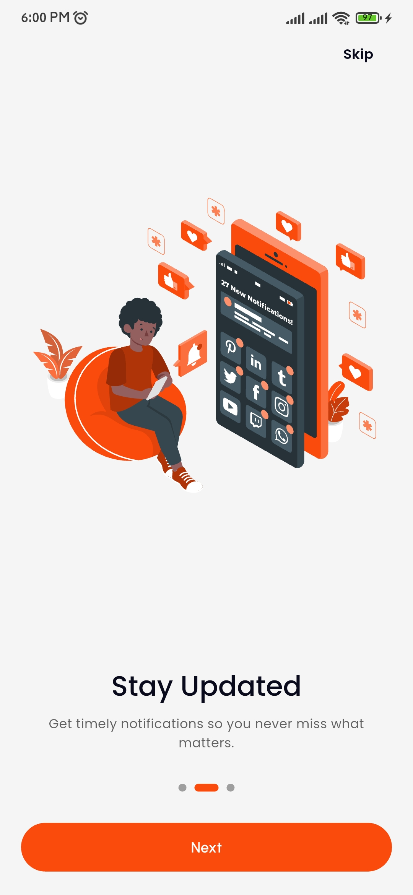
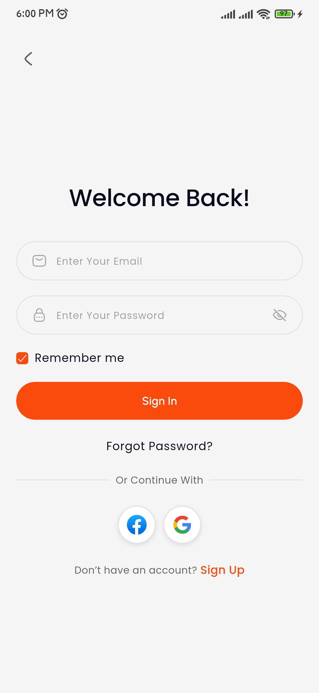
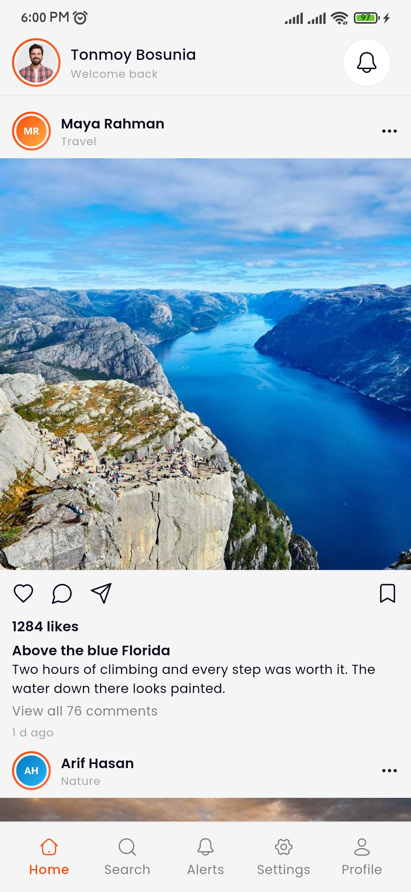
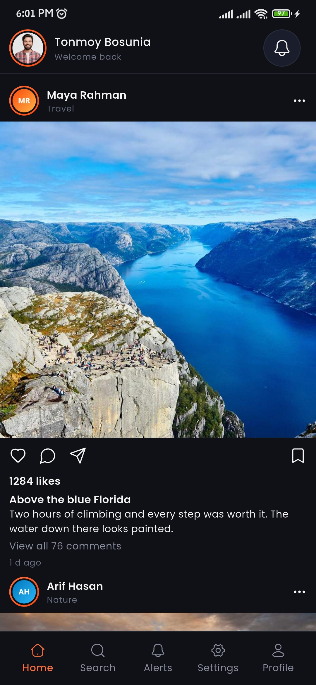
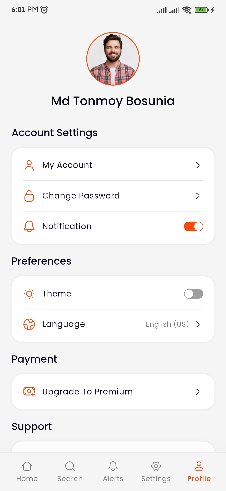
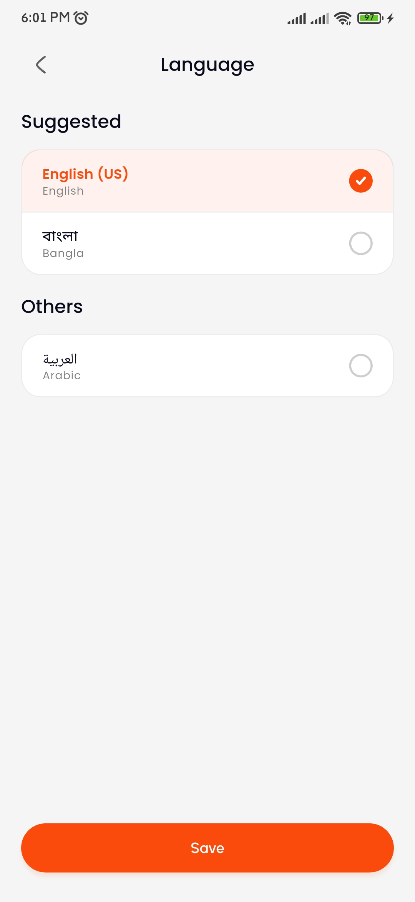
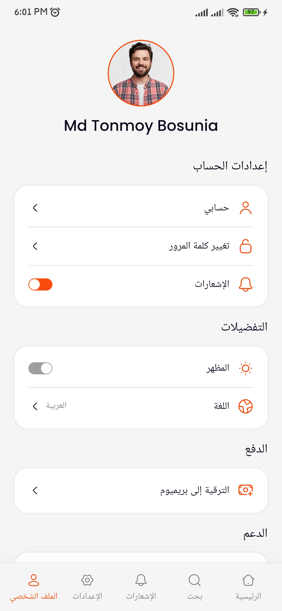

<div align="center">

# 🚀 Flutter Architecture Template

**A production-ready, feature-first Flutter starter built on GetX.**

[](https://flutter.dev)
[](https://dart.dev)
[](https://pub.dev/packages/get)
[](#-requirements)
[](LICENSE)

</div>

Every screen follows the same `View → Controller → Repository → NetworkCaller`
layering, the design system is token-based (colors, text styles, sizes), and the
rules are enforced by tests, so the codebase stays consistent as it grows.

Out of the box you get: splash → onboarding → login → a 5-tab main shell, light
and dark themes, English / বাংলা / العربية (with RTL), responsive sizing for
mobile, tablet, desktop and TV, and a network layer with secure token storage
and automatic token refresh.

---

## 📑 Table of Contents

- [Screenshots](#-screenshots)
- [Requirements](#-requirements)
- [Getting Started](#-getting-started)
- [Directory Structure](#-directory-structure)
- [Features](#-features)
- [Connecting Your Backend](#-connecting-your-backend)
- [Usage Example](#-usage-example)
- [Adding a New Feature](#-adding-a-new-feature)
- [Customization](#-customization)
- [Rename & Rebrand](#-rename--rebrand)
- [Testing](#-testing)
- [Tech Stack](#-tech-stack)
- [Known Limitations & Roadmap](#-known-limitations--roadmap)
- [Contributing](#-contributing)
- [License](#-license)

---

## 📸 Screenshots

<table width="100%">
  <tr>
    <th width="25%">Onboarding</th>
    <th width="25%">Login</th>
    <th width="25%">Home · Light</th>
    <th width="25%">Home · Dark</th>
  </tr>
  <tr>
    <td width="25%"></td>
    <td width="25%"></td>
    <td width="25%"></td>
    <td width="25%"></td>
  </tr>
  <tr>
    <th width="25%">Profile</th>
    <th width="25%">Language</th>
    <th width="25%">Profile · Arabic (RTL)</th>
    <th width="25%"></th>
  </tr>
  <tr>
    <td width="25%"></td>
    <td width="25%"></td>
    <td width="25%"></td>
    <td width="25%"></td>
  </tr>
</table>

---

## 🧰 Requirements

| Tool | Version |
| --- | --- |
| Flutter | 3.47 or newer (stable) |
| Dart | 3.13.7 or newer |
| Android | `minSdk` = Flutter default (`flutter.minSdkVersion`) |
| iOS | 15.0 or newer |
| Xcode / Android Studio | Latest stable, for platform builds |

Android and iOS are the primary targets. The web, Windows, macOS and Linux
runners are included, but check the
[Known Limitations](#-known-limitations--roadmap) before shipping to them.

---

## 🚀 Getting Started

1. **Clone the repository**
   ```bash
   git clone https://github.com/tonmoybosunia24/flutter_template.git
   cd flutter_template
   ```

2. **Fetch dependencies**
   ```bash
   flutter pub get
   ```

3. **Run the app**
   ```bash
   flutter run --dart-define=ENV=dev
   ```

   `ENV` accepts `dev`, `staging` or `prod` (anything else falls back to
   `dev`). The environment is fixed at compile time, so a release build can't
   accidentally point at a dev server.

   To point any build at a different server, override the base URL:
   ```bash
   flutter run --dart-define=API_BASE_URL=https://your.api.com
   ```

   The `dev` and `staging` hosts point at a public mock server that serves the
   home feed (`/posts`), so the template runs with no backend of your own. Set
   your real hosts in `lib/core/config/env_config.dart`.

4. **Build a release**
   ```bash
   flutter build apk --release --dart-define=ENV=prod
   flutter build appbundle --release --dart-define=ENV=prod
   flutter build ipa --release --dart-define=ENV=prod
   ```

### CI/CD

[`.github/workflows/flutter-ci.yml`](.github/workflows/flutter-ci.yml) runs on
GitHub Actions:

| Trigger | What runs | Output |
|---|---|---|
| Pull request to `main` / `dev` | format check, `flutter analyze`, `flutter test` | coverage report |
| Push to `dev` | the checks + release APK with `ENV=dev` | APK artifact |
| Push to `main` | the checks + release APK with `ENV=staging` | APK artifact |
| Tag `v1.2.3` | the checks + signed APK and AAB with `ENV=prod` | GitHub Release |

The version name comes from the tag (or `pubspec.yaml` on branches), and the
build number is the workflow run number, so every build has a higher Android
`versionCode`. CI pins Flutter in `FLUTTER_VERSION`; bump it when you upgrade
locally.

**Release signing.** Create an upload keystore once
([Flutter guide](https://docs.flutter.dev/deployment/android#sign-the-app)),
then add these repository secrets under *Settings → Secrets and variables →
Actions*:

| Secret | Value |
|---|---|
| `ANDROID_KEYSTORE_BASE64` | `base64 -w 0 upload-keystore.jks` |
| `ANDROID_KEYSTORE_PASSWORD` | keystore password |
| `ANDROID_KEY_ALIAS` | key alias, e.g. `upload` |
| `ANDROID_KEY_PASSWORD` | key password |

Without them, branch builds are signed with debug keys and tag releases fail.
For signed local builds, create `android/key.properties` (git-ignored) with
`storeFile`, `storePassword`, `keyAlias` and `keyPassword`.

**Releasing:**
```bash
git tag v1.0.0
git push origin v1.0.0
```

---

## 🏗 Directory Structure

```text
lib/
├── main.dart                       # Entry point: GetStorage init + StorageService registration
├── app.dart                        # GetMaterialApp: ScreenUtil, themes, locales, routes
├── bindings/
│   └── app_binding.dart            # Global dependency injection (NetworkCaller, ...)
├── core/                           # Foundation shared by every feature
│   ├── core.dart                   # Barrel export (everything except network/)
│   ├── config/                     # EnvConfig: dev / staging / prod + base URL
│   ├── network/                    # NetworkCaller, ApiEndpoints, ResponseData, AppError
│   ├── storage/                    # StorageService (GetStorage + FlutterSecureStorage), StorageKeys
│   ├── theme/                      # AppColors, AppColorScheme (light/dark), AppTheme
│   ├── localization/               # AppTranslations + langs/{en_us, bn_bd, ar_sa}
│   ├── utils/                      # AppSizeClass, AppDimensions, AppStrings, asset paths,
│   │                               # validators, extensions, AppLogger, SettingsUtil,
│   │                               # ViewStateMixin (screen states), DevScenario
│   └── widgets/                    # Custom* reusable widgets (button, text field, app bar,
│                                   # state view, skeletons, dev switcher, ...)
├── features/                       # One folder per feature
│   ├── splash/                     # Startup work + routing to onboarding / login / main
│   ├── onboarding/                 # First-run pager
│   ├── auth/                       # Login screen (UI + form state)
│   ├── main/                       # Bottom navigation shell (IndexedStack of tabs)
│   ├── home/                       # Feed: the reference vertical slice (see below)
│   ├── search/                     # "Coming soon" placeholder tab
│   ├── notification/               # "Coming soon" placeholder tab
│   ├── settings/                   # "Coming soon" placeholder tab
│   └── profile/                    # Theme switch, language screen, menu
└── routes/
    ├── app_routes.dart             # Route name constants
    └── app_pages.dart              # Route → screen + binding mappings

test/                               # Mirrors lib/
docs/ARCHITECTURE.md                # Full architecture & style guide
docs/CRASHLYTICS.md                 # Optional: adding Firebase Crashlytics
AGENTS.md                           # Condensed rules for AI coding agents
```

Each feature uses the same internal layout:

```text
features/<feature>/
├── binding/<feature>_binding.dart
├── controller/<feature>_controller.dart
├── model/<feature>_<model>.dart          # optional: immutable, const constructor + fromJson
├── repository/<feature>_repository.dart  # optional: the only layer that talks to NetworkCaller
├── view/<feature>_screen.dart            # GetView<FeatureController>, no logic
└── widgets/<feature>_<widget>.dart       # optional: feature-only sub-widgets
```

**`home` is the reference implementation.** It is a complete vertical slice:
binding → controller → repository → typed model (`HomePost`) → view, with a
skeleton while loading, empty / error / offline screens, pull-to-refresh and a
create-post flow. Copy its shape when you add a feature.

---

## ✨ Features

### 🏗 Feature-First Clean Architecture
- **Strict layering**: View → Controller → Repository → `NetworkCaller`. Views,
  widgets and controllers never import `core/network/`; only repositories do.
- **Repository pattern**: JSON → typed model mapping happens in the
  repository (`response.mapData<T>(...)`), so controllers only handle state.
- **Lazy bindings**: each route registers its controller with `Get.lazyPut`, so
  it is created when the screen opens and disposed when it closes.
- **Logic-free views**: screens are `GetView<Controller>` with a `const`
  constructor. All state lives in the controller as `.obs` values.

### 📡 Network Layer (`NetworkCaller`)
- **One result type**: every call returns `ResponseData<T>` with either `data`
  or a typed `AppError` (no internet, timeout, 400/401/403/404/5xx, unknown).
  The UI decides how to show it.
- **Secure tokens**: access and refresh tokens are kept in
  `FlutterSecureStorage`; preferences and flags in `GetStorage`.
- **Automatic token refresh**: an expired access token is refreshed before the
  request is sent, and a `401` triggers one refresh and one retry.
- **Single-flight refresh**: parallel requests share a single refresh call, so
  a backend that rotates refresh tokens won't log the user out.
- **Safe logout rules**: only a refused refresh (400/401/403) logs the user
  out. Network errors, timeouts and 5xx keep the session.
- **Connectivity guard**: requests fail fast with `AppError.noInternet` when
  the device is offline, and also when it is on a network that can't reach the
  server (e.g. Wi-Fi without internet).
- **File uploads**: `multipartPostRequest` with the same refresh-and-retry
  behaviour.
- **Testable**: `NetworkCaller` accepts an `http.Client`, a connectivity check
  and a storage instance, so it is unit-tested without sockets or plugins.

### 🎨 Design System
- **Color tokens**: `AppColorScheme` is a `ThemeExtension` with light and dark
  variants. Read it with `context.appColors`; no hardcoded colors in UI.
- **Typography**: `CustomText` + `context.textTheme` styles (Poppins via Google
  Fonts), scaled automatically.
- **Dimension tokens**: every padding, radius, icon and font size comes from
  `AppDimensions`.
- **Typed assets**: `IconPath` (SVG icons), `IllustrationPath` (artwork) and
  `ImagePath` (photos). No `'assets/...'` strings in code.
- **Reusable widgets**: `CustomAppBar`, `CustomButton`, `CustomPillButton`,
  `CustomTextField`, `CustomText`, `CustomSvgIcon`, `CustomNetworkImage`,
  `CustomRingAvatar`, `CustomLoader`, `CustomComingSoon`, `CustomStateView`,
  `CustomScreenState`, `CustomSkeleton`, `CustomSkeletonBox`.

### 🧩 Screen States & Dev Switcher
- **One pattern for every data screen**: the controller mixes in
  `ViewStateMixin` and implements `fetchData()`; the view wraps its content in
  `CustomStateView`. You get a **skeleton** while loading, **empty**,
  **error** and **offline** screens with a retry button, and pull-to-refresh,
  all looking the same across the app.
- **Safe by default**: a reply from an older request or from a closed screen
  is ignored, and a failed refresh keeps the content on screen with a snackbar
  instead of replacing it with an error.
- **Dev scenario switcher**: in debug builds every data screen shows a round
  ⚙ button. Pick **Live, Loading, Empty, Error or Offline** to see that state
  without touching the backend. Release builds don't include it.

### 📱 Responsive Engine
- **`flutter_screenutil`** with a `412 × 917` design size.
- **`AppSizeClass`** detects mobile, tablet, desktop and TV, and exposes
  `maxContentWidth`, `horizontalPadding` and `getValue<T>(mobile:, tablet:,
  desktop:, tv:)` for breakpoint-specific values.
- **Context-free helpers**: `getWidth`, `getHeight`, `getRadius` and `getSp`
  work anywhere, e.g. `getHeight(AppDimensions.space24)`.

### 🌍 Localization & RTL
- **Three languages**: English (`en_US`), Bengali (`bn_BD`) and Arabic
  (`ar_SA`). Every key lives in `AppStrings` and is read with `.tr`.
- **RTL**: Arabic flips the layout. Directional icons flip with it
  (`flipInRtl: true`), and spacing uses `EdgeInsetsDirectional`.
- **Persisted settings**: theme (light / dark / system) and language are saved
  and restored on launch via `SettingsUtil.changeTheme` /
  `SettingsUtil.changeLanguage`.

### 🧭 App Flow
- **Splash** runs startup work in parallel with a minimum display time, then
  routes to onboarding (first run), main (valid session) or login.
- **Main shell** keeps all five tabs alive in an `IndexedStack`, so scroll
  position and state survive tab switches.
- **Placeholder tabs** (search, notifications, settings) use
  `CustomComingSoon`. Replace them with your screens in
  `lib/features/main/view/main_screen.dart` and keep the tab list in
  `MainController` in the same order.

### 🤖 AI-Agent Ready
`AGENTS.md` holds the condensed coding rules, and `CLAUDE.md` imports it, so
Claude Code, Cursor, Codex and other agents follow the same conventions as
human contributors. The long-form guide is in `docs/ARCHITECTURE.md`.

---

## 🔌 Connecting Your Backend

`NetworkCaller` works with most REST APIs as-is. This is the contract it
expects. If your API differs, adjust `lib/core/network/network_caller.dart`.

### Authentication header
Every request (except calls made with `isAuthCall: true`) sends:
```http
Authorization: Bearer <access_token>
Accept: application/json
Content-Type: application/json
```

### Success responses (`2xx`)
Both shapes work:

```jsonc
// 1. Envelope: `data` is unwrapped and becomes ResponseData.data
{ "status": "success", "data": { "id": 1, "title": "Hello" } }

// 2. Plain JSON: the whole body becomes ResponseData.data
{ "id": 1, "title": "Hello" }
```

An empty body (e.g. `204 No Content`) is a success with `data == null`. A
non-JSON body is returned as a raw `String`.

### Error responses (`4xx` / `5xx`)
If the body has a `message` field, it is shown to the user as-is. Otherwise a
translated default for the status code is used.

```json
{ "message": "Email is already registered" }
```

### Token refresh
When the access token has expired, or a request returns `401`, the app calls:

```http
POST {baseUrl}/auth/refresh
Content-Type: application/json

{ "refresh_token": "<refresh_token>" }
```

and expects:

```json
{
  "data": {
    "access_token": "new-access-token",
    "refresh_token": "new-refresh-token",
    "expires_in": 3600
  }
}
```

`expires_in` is the access token's lifetime **in seconds** (a number or
numeric text). If it's missing, the app reads the `exp` claim when the access
token is a JWT. If neither exists, the expiry stays unknown: the app doesn't
refresh ahead of time and refreshes when a request returns `401`. A token with
a known expiry is refreshed 30 seconds early, so it never runs out on the way
to the server.

The refresh call is judged by its status code:

| Refresh response | What happens |
| --- | --- |
| `200` with valid tokens | Tokens saved, original request retried once |
| `400` / `401` / `403` | Session cleared, user sent to login |
| `5xx`, timeout, no network | Session kept, request fails with an error |

### Endpoints
All URLs live in `lib/core/network/api_endpoints.dart` as getters built from
`EnvConfig.baseUrl`:

```dart
static String get loginEndpoint => '$baseUrl/auth/login';
static String get refreshToken  => '$baseUrl/auth/refresh';
static String get logoutEndpoint => '$baseUrl/auth/logout';
```

### Wiring up login
The login screen ships as UI only. To connect it, add an `AuthRepository` that
calls `ApiEndpoints.loginEndpoint` with `isAuthCall: true` (so no stale token is
attached) and stores the result with
`StorageService.saveTokens(accessToken:, refreshToken:, expiresIn:)`. Pass
`expires_in` exactly as the server sends it (or leave it out); `StorageService`
works out the expiry. The splash screen already treats a saved token as a
logged-in session. The profile tab's **Logout** button
(`ProfileController.logout`) clears the tokens and opens login; if your backend
has a logout endpoint, call it there before `clearAuth()`.

---

## 🧑‍💻 Usage Example

A screen that loads data touches five files. This is the pattern `home` uses
(the full guide is in `docs/ARCHITECTURE.md` §3.3).

**1. Endpoint** — `lib/core/network/api_endpoints.dart`
```dart
static String get products => '$baseUrl/products';
```

**2. Repository** — `lib/features/shop/repository/shop_repository.dart`
```dart
/// Loads shop data and maps API responses into typed models. Params: [networkCaller]: makes the requests. Defaults to the registered [NetworkCaller].
class ShopRepository {
  final NetworkCaller _caller;

  ShopRepository({NetworkCaller? networkCaller})
    : _caller = networkCaller ?? Get.find<NetworkCaller>();

  // Fetches every product.
  Future<ResponseData<List<ShopProduct>>> getProducts() async {
    final response = await _caller.getRequest(ApiEndpoints.products);
    try {
      return response.mapData<List<ShopProduct>>(
        (data) => (data as List<dynamic>)
            .map((item) => ShopProduct.fromJson(item as Map<String, dynamic>))
            .toList(),
      );
    } catch (e, stackTrace) {
      AppLogger.logError('Unexpected products response', e, stackTrace);
      return ResponseData.failure(
        error: AppError.unknown,
        statusCode: response.statusCode,
      );
    }
  }
}
```

**3. Controller** — `lib/features/shop/controller/shop_controller.dart`
```dart
/// Holds the shop screen state: loads the product list and picks the screen state.
class ShopController extends GetxController with ViewStateMixin {
  final ShopRepository _repository = Get.find<ShopRepository>();

  final RxList<ShopProduct> products = <ShopProduct>[].obs;

  // Loads the products. ViewStateMixin calls it on init; retry and pull-to-refresh call it too.
  @override
  Future<void> fetchData() async {
    final response = await runLoad(_repository.getProducts);
    // Null when the screen closed, a newer load started, or a dev scenario is forced.
    if (response == null) return;

    if (response.isSuccess) products.assignAll(response.data ?? const []);
    showResult(
      isSuccess: response.isSuccess,
      isEmpty: products.isEmpty,
      error: response.errorMessage, // already translated
      isOffline: response.error?.isNoInternet ?? false,
    );
  }
}
```

`ViewStateMixin` gives the controller `state`, `isLoading` and `errorMessage`,
and calls `fetchData()` on init, so don't call it again in `onInit`.

**4. Binding** — `lib/features/shop/binding/shop_binding.dart`
```dart
/// Registers [ShopRepository] and [ShopController] for the shop screen.
class ShopBinding extends Bindings {
  @override
  void dependencies() {
    Get.lazyPut<ShopRepository>(() => ShopRepository());
    Get.lazyPut<ShopController>(() => ShopController());
  }
}
```

**5. View** — `lib/features/shop/view/shop_screen.dart`
```dart
body: Obx(
  () => CustomStateView(
    state: controller.state.value,
    isRetrying: controller.isLoading.value,
    errorMessage: controller.errorMessage.value,
    onRetry: controller.fetchData,
    loadingChild: const ShopProductSkeleton(), // optional: shaped like a product card
    emptyTitle: AppStrings.shopEmptyTitle.tr,  // optional
    child: const ShopProductList(), // RefreshIndicator(onRefresh: controller.fetchData) + list
  ),
),
```

---

## ➕ Adding a New Feature

1. Create `lib/features/<feature>/` with `binding/`, `controller/` and `view/`
   (plus `model/`, `repository/`, `widgets/` when needed).
2. Add any new endpoint as a getter in `lib/core/network/api_endpoints.dart`.
3. Add new strings to `AppStrings` and translate them in `en_us.dart`,
   `bn_bd.dart` and `ar_sa.dart`.
4. Add the route name to `AppRoutes` and register the page + binding in
   `AppPages`. For a main tab, register its binding in `MainBinding` instead.
5. If the screen loads data, use `ViewStateMixin` + `CustomStateView` (see the
   usage example above) and check every state with the ⚙ dev switcher.
6. Run `flutter analyze` and `flutter test`. The architecture test will flag
   anything that breaks the conventions.

See `docs/ARCHITECTURE.md` for the full rules.

---

## 🎨 Customization

### Brand colors
Edit the light and dark values in `lib/core/theme/app_colors.dart`
(e.g. `primaryLight`, `primaryDark`). The UI reads them through
`AppColorScheme`, so every screen updates. For a **new** color token, add the
light + dark constants to `AppColors`, then wire the token into
`AppColorScheme` (`light`, `dark`, `copyWith` and `lerp`).

### Font
The app uses Poppins via `google_fonts`. Change the font in
`lib/core/theme/app_theme.dart` (`GoogleFonts.poppins(...)`).

### Spacing & sizes
Add or tweak tokens in `lib/core/utils/app_dimensions.dart`. Change the design
size (`412 × 917`) in `lib/app.dart` if your designs use a different frame.

### Adding a language
1. Create `lib/core/localization/langs/<lang>_<country>.dart` with every key
   from `en_us.dart` translated.
2. Register it in `AppTranslations` (`lib/core/localization/app_translations.dart`).
3. Add a language code to `StorageKeys` and handle it in
   `SettingsUtil.changeLanguage` and in the locale switch in `lib/app.dart`.
4. Add the `Locale` to `supportedLocales` in `lib/app.dart`.
5. Add an `AppStrings` key for the language's name and list it in
   `LanguageController` so it appears on the language screen.

`app_translations_test.dart` fails if the new file is missing any key.

### App icon & native splash
Not preconfigured. Use
[`flutter_launcher_icons`](https://pub.dev/packages/flutter_launcher_icons) and
[`flutter_native_splash`](https://pub.dev/packages/flutter_native_splash).

---

## 🛠 Rename & Rebrand

### 1. Manual method
| What | File | Key |
| --- | --- | --- |
| App name (Android) | `android/app/src/main/AndroidManifest.xml` | `android:label` |
| App name (iOS) | `ios/Runner/Info.plist` | `CFBundleDisplayName`, `CFBundleName` |
| Package name (Android) | `android/app/build.gradle.kts` | `applicationId`, `namespace` |
| Bundle ID (iOS) | `ios/Runner.xcodeproj/project.pbxproj` | `PRODUCT_BUNDLE_IDENTIFIER` |
| In-app title | `lib/core/localization/langs/*.dart` | `AppStrings.appName` value |

### 2. Automatic method (`rename` package)
`rename` is already in `dev_dependencies`, so you only need to run it:

```bash
# Package name / bundle ID
dart run rename setBundleId --value "com.yourdomain.appname"

# App name shown under the launcher icon
dart run rename setAppName --value "Your App Name"
```

### Permissions
The template declares only network permissions (`INTERNET`,
`ACCESS_NETWORK_STATE`, `ACCESS_WIFI_STATE`). Add others only when a feature
needs them, so store review doesn't flag unused permissions. For example, a
photo upload with `image_picker` needs `NSCameraUsageDescription` and
`NSPhotoLibraryUsageDescription` in `ios/Runner/Info.plist`, written for your
app; on Android the plugin handles it without extra permissions.

---

## ✅ Testing

```bash
dart format lib test   # CI fails on unformatted files
flutter analyze        # keep at 0 warnings / 0 errors
flutter test
```

| Area | What is covered |
| --- | --- |
| Network | Response parsing, error mapping, token refresh, single-flight refresh, logout rules, timeouts, offline short-circuit, no internet on connection failure, file-upload retry |
| Screen states | `ViewStateMixin`: content / empty / error / offline, failed refresh keeps content, late and closed replies ignored, forced dev scenarios |
| Utils & widgets | Validators, `AppError` translation, `CustomButton` |
| Localization | Every locale has every key with a non-empty value |
| Architecture | Fails on hardcoded colors, raw `Text`, hardcoded asset paths, `print`/`debugPrint`, network imports in views/controllers, `_buildXxx()` methods, hoisted sizes, `fontSize`/`fontWeight` on `CustomText`, unprefixed feature widgets, malformed doc comments |

Unit tests inject fakes (`MockClient` from `package:http/testing.dart`, a fake
`StorageService`) instead of touching platform channels. Widget tests pump
inside `ScreenUtilInit(designSize: const Size(412, 917))`.

---

## 📦 Tech Stack

| Concern | Package |
| --- | --- |
| State, DI, routing, translations | [`get`](https://pub.dev/packages/get) |
| Responsive sizing | [`flutter_screenutil`](https://pub.dev/packages/flutter_screenutil) |
| Preferences | [`get_storage`](https://pub.dev/packages/get_storage) |
| Secure token storage | [`flutter_secure_storage`](https://pub.dev/packages/flutter_secure_storage) |
| HTTP | [`http`](https://pub.dev/packages/http) |
| Connectivity | [`connectivity_plus`](https://pub.dev/packages/connectivity_plus) |
| SVG icons | [`flutter_svg`](https://pub.dev/packages/flutter_svg) |
| Fonts | [`google_fonts`](https://pub.dev/packages/google_fonts) |
| Logging | [`logger`](https://pub.dev/packages/logger) (via `AppLogger`) |
| Lints | [`flutter_lints`](https://pub.dev/packages/flutter_lints) |

---

## 🗺 Known Limitations & Roadmap

What the template does **not** do yet, so you know what to add before going to
production:

- [ ] **Login API**: the login screen is UI only (see
      [Wiring up login](#wiring-up-login)).
- [ ] **iOS CI**: the workflow builds Android only. Add a macOS job with
      code signing if you ship to the App Store.
- [ ] **Flavors**: environments are compile-time `--dart-define` values, not
      Gradle/Xcode flavors. Add real flavors if you need a separate app ID or
      icon per environment.
- [ ] **Crash reporting & analytics**: nothing is wired in. Follow
      [`docs/CRASHLYTICS.md`](docs/CRASHLYTICS.md) to add Firebase Crashlytics
      step by step.
- [ ] **App icon & native splash**: still the Flutter defaults.
- [ ] **Desktop & web**: macOS needs the Keychain Sharing entitlement for
      `flutter_secure_storage`, and web has no truly secure storage. Review
      token storage before shipping to these platforms.

---

## 🤝 Contributing

Contributions are welcome and **greatly appreciated**.

1. Fork the project
2. Create your feature branch (`git checkout -b feature/AmazingFeature`)
3. Follow the rules in `AGENTS.md` / `docs/ARCHITECTURE.md`
4. Make sure `flutter analyze` and `flutter test` pass
5. Commit your changes (`git commit -m 'Add some AmazingFeature'`)
6. Push to the branch (`git push origin feature/AmazingFeature`)
7. Open a pull request against `dev`

---

## 📄 License

Distributed under the **MIT License**. See [`LICENSE`](LICENSE) for details.

Copyright © 2026 Md Tonmoy Bosunia
